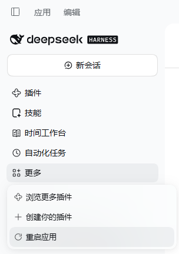
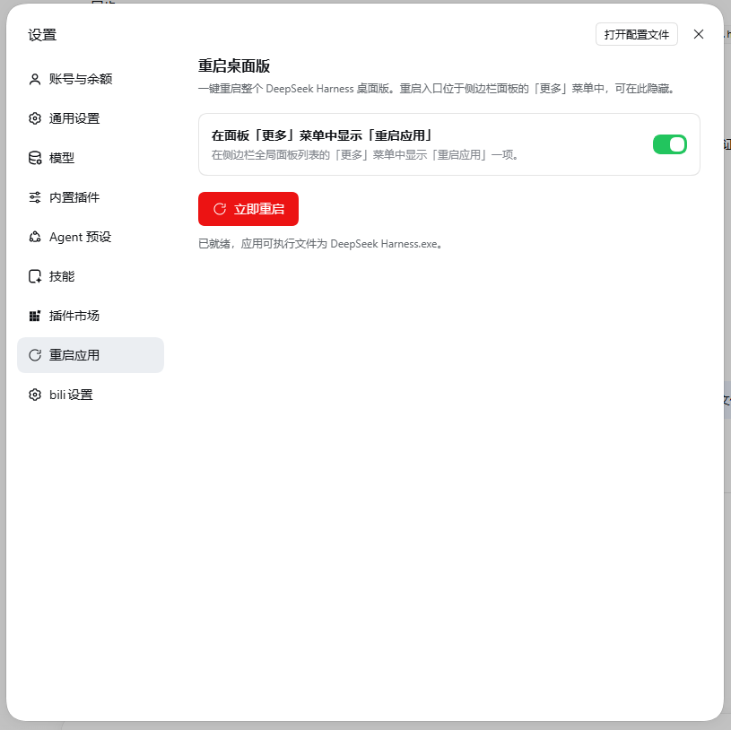

# Desktop Restart · dsh-desktop-restart

[简体中文](README.md) | English

> A DSH plugin that adds a **one-click "restart the whole app"** entry to the **DeepSeek Harness desktop app**.

## Overview

The DeepSeek Harness desktop app has no built-in "restart application" button, so after changing settings or installing a new plugin you often have to close and reopen it manually.
This plugin adds a **Restart app** entry to the sidebar panel list's **More ⋯** menu — one click closes and relaunches the entire desktop app. It also ships a settings page to **show / hide** the entry and to restart immediately.

Works on the **Windows / macOS / Linux** desktop app (see *Platform & compatibility* below).

## Features

- **Sidebar "More" menu entry**: lives in the **More ⋯** menu at the top-right of the sidebar panel list; icon size and color match the host's native menu rows.
- **One-click full restart**: not just a page reload — it terminates the current process and relaunches the whole desktop app.
- **Settings page**: under *Settings → Desktop restart*, toggle *Show in More menu* and use *Restart now*.
- **Persistent**: the toggle is stored in `~/.dsh/desktop-restart-plugin.json` and defaults to on.
- **Safe degradation**: on non-desktop environments (web / headless) the entry is hidden automatically.

## What it looks like

**① The "Restart app" entry in the sidebar "More ⋯" menu**

After installation, open the **More ⋯** menu at the top-right of the sidebar panel list:



**② The "Settings → Desktop restart" page**

The settings page contains a *Show "Restart app" in the panel "More" menu* switch and a *Restart now* button:



## Installation

This is a standard **DSH Bundle plugin**, installed into the DSH **desktop** plugin profile (`~/.dsh/profiles/desktop`).

### Option 1: Plugin marketplace (recommended)

Search for `dsh-desktop-restart` in the DSH plugin marketplace and install.

### Option 2: Install from a local directory

Put this repository on your machine, then run `plugin_manager`'s `install_bundle` with the **absolute path** of the repository, for example:

```
plugin_manager  action: install_bundle  target: <absolute path to this repo>
```

After installation, **restart the desktop app once** (or reload the plugin) to load the plugin's host half; then refresh the window to see the entry.
> Note: the plugin's **host half** (`index.js`) is loaded at app startup and is not hot-reloaded — restart/reload the plugin after changing it. The **UI half** (`client.js`) only needs a window refresh.

## Usage

- **Restart**: click **Restart app** in the sidebar **More ⋯** menu, then confirm; the app closes and relaunches automatically.
- **Toggle the entry**: go to *Settings → Desktop restart* and turn *Show in More menu* on or off.
- **Restart now**: use the *Restart now* button on the same settings page.

## Configuration

| Key | Location | Description | Default |
| --- | --- | --- | --- |
| `showInPanelMenu` | `~/.dsh/desktop-restart-plugin.json` | Whether to show *Restart app* in the sidebar More menu | `true` |

Example settings file:

```json
{
  "showInPanelMenu": true
}
```

> The file is written by the plugin and can be changed from the settings page; manual editing is usually unnecessary.

## How it works

1. Clicking **Restart app** calls the host route `POST /api/dsh-desktop-restart` (`action: "restart"`) via a same-origin request.
2. The host plugin (running inside the desktop app's host child process) writes a helper script into the system temp dir — `.bat` on Windows, `.sh` on macOS / Linux.
3. The helper is launched **detached** so it survives the app being killed:
   - **Windows**: `taskkill /F /IM "DeepSeek Harness.exe"` to stop the app, `powershell Stop-Process` as a fallback; clear `ELECTRON_RUN_AS_NODE`, `cd` into the app directory, then `start "" "<app exe>"` to relaunch.
   - **macOS**: `pkill -f "<app binary>"` to stop the app; clear `ELECTRON_RUN_AS_NODE`, then `open -n "<DeepSeek Harness.app>"` to reopen the app bundle.
   - **Linux**: `pkill -f "<app binary>"` to stop the app; clear `ELECTRON_RUN_AS_NODE`, then relaunch according to the packaging: Flatpak (`$FLATPAK_ID`) prefers `flatpak-spawn --host flatpak run`, then `flatpak run`; Snap (`$SNAP`) uses `snap run`; AppImage uses `$APPIMAGE`; otherwise the executable directly (with the same fallback).
4. A log is written to `dsh-desktop-restart/restart.log` in the temp dir for troubleshooting.

> Why clear `ELECTRON_RUN_AS_NODE`: the plugin host child process is started with `ELECTRON_RUN_AS_NODE=1`. If not cleared, the relaunched process would run as plain Node and exit immediately (with no window). On macOS `open` goes through LaunchServices and normally won't inherit it, but the script clears it anyway for safety.

## Platform & compatibility

- **Platform**: **Windows / macOS / Linux** desktop app.
  - Windows uses `taskkill` / `Stop-Process` / `start`;
  - macOS uses `pkill` / `open -n` (on the `.app` bundle);
  - Linux uses `pkill` / `nohup` (the relaunch target is resolved as Flatpak → `flatpak run`, Snap → `snap run`, AppImage → `$APPIMAGE`, otherwise the executable).
- **Environment**: requires the DSH desktop app (Electron). Web / headless environments hide the entry automatically.
- **Verified against**: DeepSeek Harness Desktop `0.2.2-rc.5` (Electron `44.x`, Node `24.x`) on Windows; the macOS / Linux paths are implemented from the same design and should be confirmed on the respective machines.
- **Linux packaging**: Flatpak / Snap are adapted out of the box — `$FLATPAK_ID` triggers `flatpak run` (preferring `flatpak-spawn --host` inside the sandbox), `$SNAP` triggers `snap run`, with a direct-exec fallback; if a sandbox policy still blocks it, check the restart log.
- **Launch-target debug**: the settings page shows the launch target actually resolved for this run (`kind · target`), so you can confirm restart behaviour under Flatpak / Snap / AppImage.

## Repository layout

```
dsh-desktop-restart/
├─ package.json          # DSH bundle manifest (dsh.bundle / dsh.client / exports / files)
├─ cordis.patch.yml      # Patch inserted into the DSH plugin profile
├─ index.js              # Host plugin: /api/dsh-desktop-restart, settings I/O, restart helper
├─ client.js             # UI plugin: More-menu entry + settings page
├─ locale/
│  ├─ en.json            # English metadata
│  └─ zh.json            # Chinese metadata
├─ docs/
│  ├─ DETAIL.md          # Plugin detail page (referenced by meta.detail)
│  └─ images/            # README screenshots (more-menu.png, settings-page.png)
├─ icon.svg              # Plugin icon
└─ LICENSE               # MIT
```

## Development

- No build step: `index.js` is an ES Module; `client.js` is a classic browser script registered through `window.__ModuleLoader__.load`.
- Syntax check:

```bash
node --check index.js
node --check client.js
```

- Debugging tips:
  - Editing `client.js` only needs a window refresh;
  - Editing `index.js` requires reloading the plugin / restarting the app (the host half is not hot-reloaded).

## Known limitations

- Restarting relies on system commands (Windows: `taskkill` / `powershell` / `start`; macOS / Linux: `pkill` / `open` / `nohup`), which may be denied under a restricted environment or strict policy.
- Linux Flatpak / Snap are adapted (`flatpak run` / `snap run`), but sandbox policies vary widely, so a heavily restricted environment may still fail to auto-restart; check `restart.log` to diagnose.
- The app briefly exits during a restart; make sure unsaved transient state is handled.

## License

[MIT](LICENSE) © 2026 maypu

## Disclaimer

This plugin terminates and relaunches the DeepSeek Harness desktop app process. Use it with that behavior in mind; the author is not liable for any data loss or damage caused by using this plugin.
