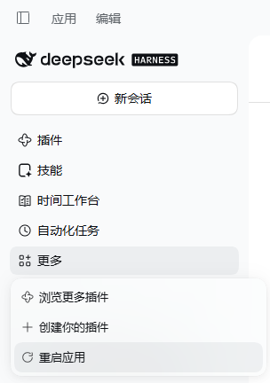
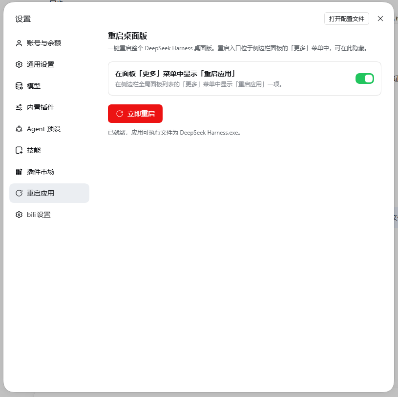

# 桌面版重启 · dsh-desktop-restart

简体中文 | [English](README.en.md)

> 为 **DeepSeek Harness 桌面版** 提供「一键重启整个应用」入口的 DSH 插件。

## 简介

DSH 桌面版本身没有「重启应用」的按钮，改了配置或装了新插件后往往要手动关闭再打开。
本插件在侧边栏面板列表的「更多 ⋯」菜单里加入一个 **重启应用** 入口，点一下即可关掉并重新拉起整个桌面应用；
同时提供一个设置页，用于 **显示 / 隐藏** 该入口，以及「立即重启」。

## 功能

- **侧边栏「更多」菜单入口**：位于左侧栏面板列表右上角的「更多 ⋯」菜单中，图标尺寸与颜色和宿主原生菜单项保持一致。
- **一键重启整个应用**：不只是刷新页面，而是结束当前进程并重新启动 `DeepSeek Harness.exe`。
- **设置页**：在「设置 → 桌面版重启」中可开关「在更多菜单中显示」，并可「立即重启」。
- **持久化**：开关状态保存在 `~/.dsh/desktop-restart-plugin.json`，默认开启。
- **安全降级**：在非桌面环境（Web / 无头 / 非 Windows）下自动隐藏入口，不会误操作。

## 效果

**① 侧边栏「更多 ⋯」菜单中的「重启应用」入口**

安装后，打开左侧栏面板列表右上角的「更多 ⋯」菜单，即可看到「重启应用」一项：



**② 「设置 → 桌面版重启」设置页**

设置页中包含「在面板『更多』菜单中显示『重启应用』」开关，以及「立即重启」按钮：



## 安装

本插件是一个标准的 **DSH Bundle 插件**，需要安装在 DSH **桌面版** 的插件配置（`~/.dsh/profiles/desktop`）里。

### 方式一：插件市场（推荐）

在 DSH 插件市场搜索 `dsh-desktop-restart` 安装即可。

### 方式二：本地目录安装

把本仓库放到本地后，在 DSH 中执行 `plugin_manager` 的 `install_bundle`，目标指向本仓库的**绝对路径**，例如：

```
plugin_manager  action: install_bundle  target: <本仓库绝对路径>
```

安装完成后，**重启一次桌面应用**（或重新加载插件）以加载插件的宿主部分；随后刷新窗口即可看到入口。
> 提示：插件的「宿主部分」（`index.js`）在应用启动时加载，修改后需要重启/重载插件才会生效；「界面部分」（`client.js`）刷新窗口即可生效。

## 使用

- **重启**：点击侧边栏「更多 ⋯」菜单中的「重启应用」，确认后应用会关闭并自动重新启动。
- **开关入口**：进入「设置 → 桌面版重启」，打开或关闭「在更多菜单中显示」。
- **立即重启**：同一设置页内的「立即重启」按钮。

## 配置

| 配置项 | 位置 | 说明 | 默认 |
| --- | --- | --- | --- |
| `showInPanelMenu` | `~/.dsh/desktop-restart-plugin.json` | 是否在侧边栏「更多」菜单中显示「重启应用」 | `true` |

设置文件示例：

```json
{
  "showInPanelMenu": true
}
```

> 该文件由插件自动读写；也可以通过设置页修改，无需手动编辑。

## 工作原理

1. 点击「重启应用」后，界面通过同源请求调用宿主插件注册的接口 `POST /api/dsh-desktop-restart`（`action: "restart"`）。
2. 宿主插件（运行在 DSH 桌面版的宿主子进程中）在系统临时目录 `%TEMP%\dsh-desktop-restart\` 生成一个 `.bat` 帮助脚本。
3. 该脚本以 **detached（脱离父进程）** 的方式启动，因此能在应用被结束后继续存活：
   - 用 `taskkill /F /IM "DeepSeek Harness.exe"` 结束应用进程；
   - 再用 `powershell Stop-Process` 兜底结束残留进程；
   - 清除 `ELECTRON_RUN_AS_NODE` 环境变量，`cd` 到应用目录后 `start "" "<应用 exe>"` 重新拉起。
4. 执行日志写入 `%TEMP%\dsh-desktop-restart\restart.log`，便于排查。

> 之所以要「清除 `ELECTRON_RUN_AS_NODE`」：插件宿主子进程是以 `ELECTRON_RUN_AS_NODE=1` 启动的，若不清理，重启出的新进程会被当成纯 Node 运行而直接退出（无界面）。

## 平台与兼容性

- **平台**：仅 **Windows** 桌面版（使用 `taskkill` / `Stop-Process` / `start`）。
- **环境**：需要 DSH 桌面版（Electron）。Web / 无头环境会自动禁用并隐藏入口。
- **验证环境**：DeepSeek Harness Desktop `0.2.2-rc.5`（Electron `44.x`，Node `24.x`）。

## 目录结构

```
dsh-desktop-restart/
├─ package.json          # DSH bundle 清单（dsh.bundle / dsh.client / exports / files）
├─ cordis.patch.yml      # 注入到 DSH 插件配置的补丁
├─ index.js              # 宿主插件：注册 /api/dsh-desktop-restart、读写设置、生成并拉起重启脚本
├─ client.js             # 界面插件：注册「更多」菜单项与设置页
├─ locale/
│  ├─ en.json            # 英文元数据
│  └─ zh.json            # 中文元数据
├─ docs/
│  ├─ DETAIL.md          # 插件详情页文案（meta.detail 指向）
│  └─ images/            # README 截图（more-menu.png、settings-page.png）
├─ icon.svg              # 插件图标
└─ LICENSE               # MIT
```

## 开发

- 无构建步骤：`index.js` 为 ES Module，`client.js` 为在浏览器中加载的经典脚本（通过 `window.__ModuleLoader__.load` 注册）。
- 语法检查：

```bash
node --check index.js
node --check client.js
```

- 调试提示：
  - 修改 `client.js` 后刷新窗口即可；
  - 修改 `index.js` 后需要重载插件/重启应用（宿主部分不热重载）。

## 已知限制

- 仅支持 Windows 桌面版。
- 「重启」依赖系统命令（`taskkill` / `powershell` / `start`），在受限令牌或强策略环境中可能被拒绝。
- 重启过程中应用会短暂退出，未保存的临时状态请自行留意。

## 许可证

[MIT](LICENSE) © 2026 maypu

## 免责声明

本插件会结束并重新启动 DSH 桌面应用进程。请在了解该行为的前提下使用；因使用本插件造成的任何数据丢失或损坏，作者不承担责任。
